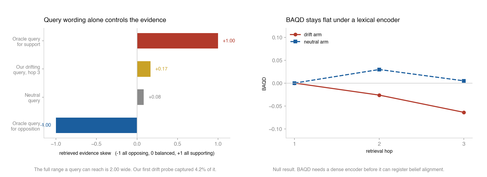

# OUROBOROS

**Detecting self-confirming retrieval loops in agentic RAG.**

[](https://github.com/vignesh2027/ouroboros/actions/workflows/ci.yml)
[](https://huggingface.co/datasets/vigneshwar234/spiral-bench)
[](LICENSE)

Live platform: **https://ouroboros.140-245-16-129.sslip.io**
Project page: **https://vignesh2027.github.io/ouroboros**
Dataset: **https://huggingface.co/datasets/vigneshwar234/spiral-bench**

---

## The problem

An agentic RAG system searches several times, and it writes each follow-up query itself, using
what it currently believes. A retriever ranks documents by how closely they match the wording of
the query it receives.

Those two facts close a loop. Belief shapes the query, the query shapes the evidence, and the
evidence hardens the belief. Opposing studies are never deleted, they are simply never asked for
again.

Nothing false is ever produced. Every document is authentic, every citation checks out, and a
faithfulness scorer rates the answer as fully faithful. It is a **sampling failure, not a truth
failure**, which is why existing safeguards cannot see it. They all read the answer. None of them
read the query.

## Result

On a corpus balanced by construction, an **oracle query** built only from vocabulary unique to one
side retrieves **100% supporting** evidence, and the reverse oracle retrieves **100% opposing**
evidence.

| Measure | Value |
|---|---|
| Range of retrieved evidence reachable by query wording alone | **2.00** |
| Share of that range captured by our first hand-written drift queries | **4.2%** |
| Vocabulary shared between supporting and opposing passages | **12.9%** |

Query wording alone controls which evidence comes back. That is the half of the loop this
experiment set out to test.

The drift metric computed over a TF-IDF encoder stayed **flat**, a null result that points at the
encoder rather than at the mechanism. Short queries share few literal words with long belief text,
so a lexical encoder measures vocabulary overlap instead of meaning.



## The metric

BAQD, or Belief-Aligned Query Drift, asks one question at every hop: is the query the system just
wrote closer to what it already believes than the user's neutral question was?

```
BAQD(n) = cos(query_n, belief_n-1) - cos(question_0, belief_n-1)
```

Three embeddings, two cosine similarities, one subtraction. No training, no labelled data, no GPU.

## Design and testing

Four design diagrams and an automated test suite cover the implemented module.

| Artefact | What it shows |
|---|---|
| [Use case diagram](docs/diagrams/use-case.svg) | Three actors, and which use cases include which sub functions |
| [Activity diagram](docs/diagrams/activity.svg) | The triple nested loop over questions, arms and hops |
| [Flowchart](docs/diagrams/flowchart-baqd.svg) | The drift score at statement level, including the empty belief guard |
| [Data flow diagram](docs/diagrams/data-flow.svg) | Which modules already exist and which ones are the contribution |
| [Review One report](https://vignesh2027.github.io/ouroboros/review1-report.html) | Requirements, diagrams, running module, 43 test cases |

```bash
python3 run_tests.py     # 43 cases, writes outputs/TEST_CASES.md
```

Two defects were found, fixed and retested during this phase.

| ID | Input | Expected | Actual | Status |
|---|---|---|---|---|
| TC-36 | `search(query, k=-1)` | Empty list | Returned the 7 worst ranked passages | **FAIL** |
| TC-36-R1 | Same input after adding a guard for `k <= 0` | Empty list | Empty list | **PASS** |
| TC-38 | Encoder fitted on one question's 8 passages | A usable vector | All zero vector, ranking was noise | **FAIL** |
| TC-38-R1 | Same query after fitting on the whole collection | A non zero vector | Non zero vector | **PASS** |

Both are now pinned by regression tests, so they cannot return without the suite failing.

## Layout

```
ouroboros/metric.py          BAQD and evidence skew
ouroboros/retrieval.py       TF-IDF encoder and cosine retriever
data/spiral_bench_v0.json    SPIRAL-Bench v0, 8 questions, 64 passages
run_experiment.py            Experiment 1, drift arm versus neutral arm
run_diagnostic.py            Locates the cause of the null result
make_chart.py                Builds the results figure
scripts/build_hf_dataset.py  Flattens the corpus for the Hub, checks balance
outputs/traces.jsonl         One row per retrieval, 48 rows
docs/                        Project page published to GitHub Pages
```

## Reproduce

No GPU, no API key, no model download.

```bash
pip install -r requirements.txt

python3 run_experiment.py    # 48 retrievals, two arms
python3 run_diagnostic.py    # oracle comparison
python3 make_chart.py        # rebuilds the figure
```

Continuous integration runs all three on every push, so the numbers above are checked rather than
asserted.

## Phase II: the live platform

Phase I tested the mechanism with queries typed in advance. Phase II closes the loop. The repo now
contains a local web app where you type any research question and a live model (a hosted language model)
runs the search itself. At every hop it reads what was retrieved, writes down what it currently
believes, then writes its own next query. We measure BAQD on that real belief and query, plus the
balance of supporting and contradicting evidence and the diversity of sources. In guarded mode the
agent injects a counter-query when drift or skew crosses a threshold, and the final answer has to
weigh both sides. The answer is then checked claim by claim against the retrieved evidence. The
Evidence Support Score is the share of claims backed by the evidence we retrieved. It is not the
probability that the answer is true, and a claim no source covers is shown as not verified, never
as false.

The platform has two parts. The landing page at `/` explains the system: the problem, a diagram of how
every part connects, how our retrieval works and the honest results so far. The app at `/app` is where you
ask. Every answer comes with numbered sources and citations, an Evidence map that shows which sources back
or contradict each claim (claims resting on a single source are marked), a Belief journey that shows how the
agent's belief and searches moved round by round and where the balance guard stepped in, and a "How this
answer was made" panel with the real numbers for that answer. There is also a Check an AI answer page for
answers from ChatGPT, Claude or Gemini, a Compare view, a Benchmark view and a How it works view. It uses
plain HTML, CSS and JavaScript with no build step, and follows the computer's light or dark setting.
app/DEMO.md is the presenter script.

The public copy runs with `PUBLIC_DEMO=1`: it never serves source files, lists only the featured example
questions, and limits how many new questions each visitor can ask per hour and the whole site per day.

To run the app:

```bash
bash run_platform.sh
# landing page: http://localhost:8000   app: http://localhost:8000/app
```

Model access is configured on the server (see the private setup notes), and `OFFLINE=1` replays cached
work only. Every model call is cached on disk under `outputs/.cache`.

To rerun the live experiment on the SPIRAL-Bench v0 closed corpus (8 questions, both modes, 4 hops,
top 3 of 8 passages per hop):

```bash
.venv/bin/python experiments/run_live_spiral.py            # live, cached
.venv/bin/python experiments/run_live_spiral.py --offline  # replay from the cache
```

It writes `outputs/live_spiral.json`. Skew and balance loss use the ground-truth stances stored in
the benchmark, while queries and beliefs are written by the model.

**Headline result, stated plainly:** guarded mode did not beat standard mode on this benchmark. On
the six contested questions the mean ground-truth balance loss at the last hop that retrieved
anything was 0.167 for both modes, and mean BAQD over hops 2 to 4 was -0.100 for standard and
-0.107 for guarded, a difference too small to call. The live model's BAQD sat near or below zero,
so on this TF-IDF measure it did not visibly bend its queries toward its own belief. The guard did
fire (0.83 counter-queries per contested guarded run, 3 per settled run) without distorting the
settled controls. The main limit is the test itself: with only 8 passages and 3 read per hop, the
pool runs dry at hop 3, so there is little room for query wording to change what is read. With 16
runs and one sample each, this is a small, honest null result and not evidence either way for
larger, real corpora.

## Honest limitations

1. The passages are **synthetic** research-style text written for this prototype. They describe
   real findings in outline but are not quotations and must not be cited as literature.
2. The benchmark is **small**: 8 questions, 64 passages.
3. Queries in v0 are **authored probes, not agent output**. Whether a live model writes queries
   like these is the open question.
4. Balance is balanced **by construction**, not by sampling from a real corpus.

## Next

A dense sentence encoder in place of TF-IDF, a live model writing its own follow-up queries, and a
larger question set.

## Team

Department of Artificial Intelligence and Data Science, Project Phase I.

| Member | Register number | Coordinates | GitHub |
|---|---|---|---|
| Harshavarthini M | TU6230103110012 | Dataset and evidence verification | [@Harsha2006-M](https://github.com/Harsha2006-M) |
| Sadhithiya V | TU6230103110024 | Literature, documentation, demo | [@sadhithiya2005-ship-it](https://github.com/sadhithiya2005-ship-it) |
| Vigneshwar L | TU6230103110040 | Pipeline and metric implementation | [@vignesh2027](https://github.com/vignesh2027) |

All three members take part in every stage. The third column shows who coordinates that part of
the work, not who works on it alone.

Project guide: **Dr. Senthil**, Networking and Database.

## License

MIT. Author: Vigneshwar L.
